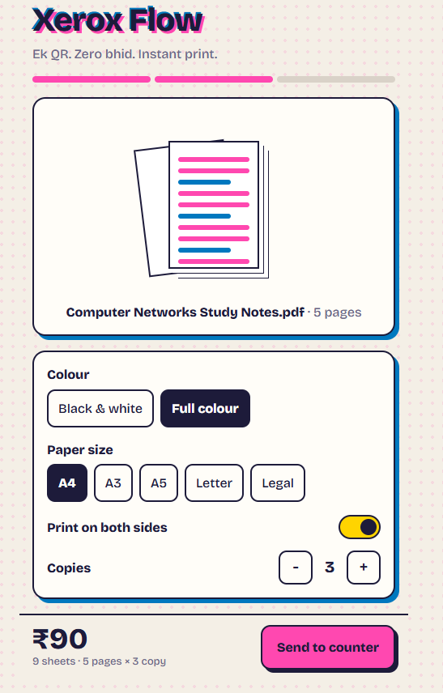
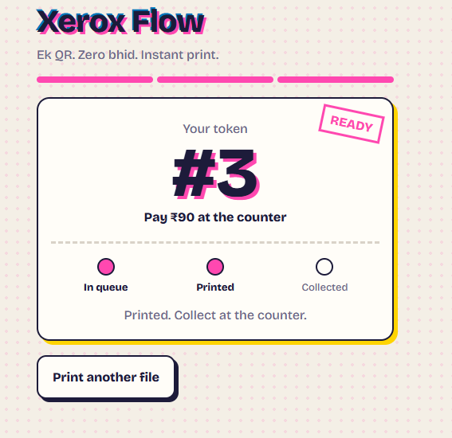
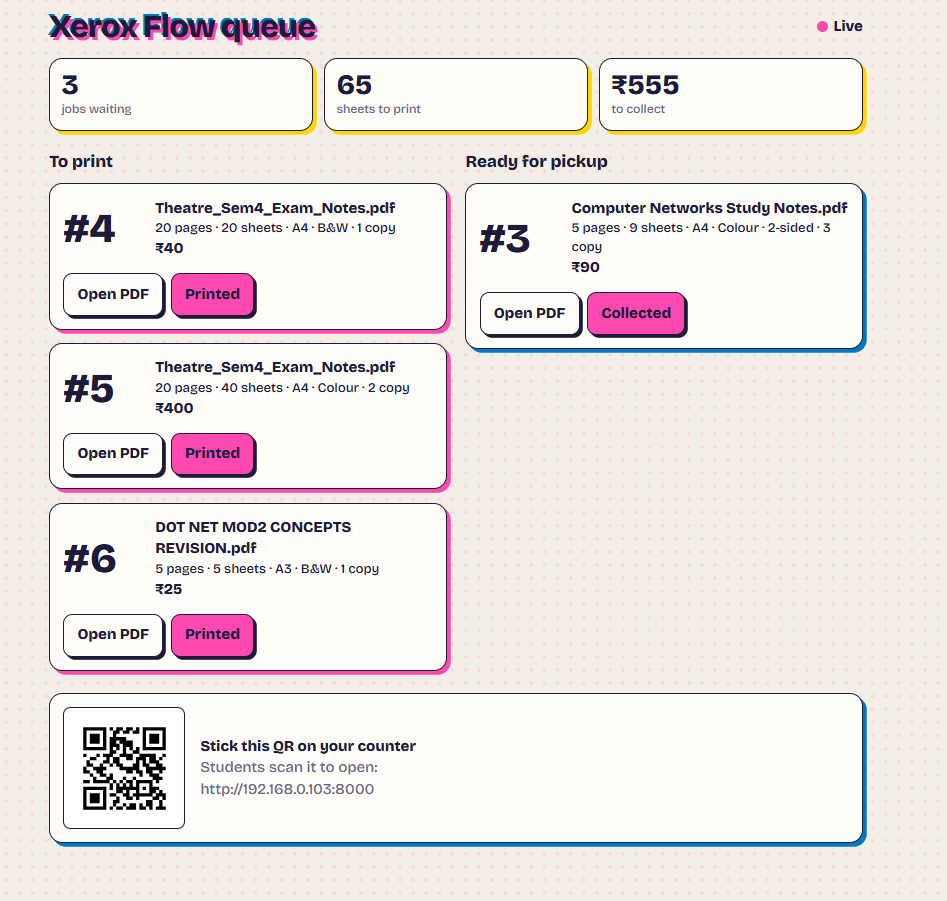

# Xerox Flow 🖨️

**Ek QR. Zero bhid. Instant print.**

Scan a QR at the xerox shop, upload your PDF, choose print settings, see the price live, and send the job straight to the shop's queue. No more crowding at the counter, no more explaining settings out loud.



<p>
  
  
</p>

> A working prototype, tested locally. The idea was inspired by a post by @only_vibecoding on Threads. I built this implementation with AI assistance while learning FastAPI, REST APIs and databases.

## What it does

**For the student (works on any phone browser, nothing to install)**
- Scan the counter QR, then drag and drop or pick a PDF (up to 20 MB)
- Page count is read automatically
- Choose black and white or colour, A3 / A4 / A5 / Letter / Legal, double-sided, and number of copies
- Live paper preview that changes with every setting, and a live price
- Get a token number and watch the status go from In queue to Printed to Collected

**For the shop owner (`/shop`, PIN protected)**
- Live queue split into *To print* and *Ready for pickup*
- Stats: jobs waiting, sheets to print, money to collect
- Open the PDF, mark it Printed, then mark it Collected
- A QR code to stick on the counter

## How it works

1. The QR code is just the server's web address.
2. The browser uploads the PDF. The server saves it and counts the pages with `pypdf`.
3. Every time a setting changes, the browser asks the server for the price, so students can't tamper with it.
4. **Send to counter** saves a job (file, settings, price, status `waiting`) in a SQLite database and returns a token.
5. The shop page asks the server for the queue every 4 seconds. The student's ticket checks its status every 3 seconds.
6. Status moves through `waiting` → `printed` → `done`.

**Price formula**

```
sheets = pages (or ceil(pages / 2) if double-sided) × copies
price  = sheets × rate for that colour and paper size
```

Example: 3 pages, black and white, A4, 1 copy = 3 × ₹2 = ₹6.

## Tech stack

Python · FastAPI · SQLite · pypdf · qrcode · HTML, CSS and vanilla JavaScript (no frameworks)

## Run it locally

You need Python 3.10 or newer.

**Windows**
```bash
python -m venv .venv
.venv\Scripts\activate
python -m pip install -r requirements.txt
python app.py
```

**Mac / Linux**
```bash
python3 -m venv .venv
source .venv/bin/activate
python -m pip install -r requirements.txt
python app.py
```

Then open:
- Student page: http://localhost:8000
- Shop page: http://localhost:8000/shop (default PIN `1234`)

To try it on a phone, connect to the same Wi-Fi and open the `http://192.168.x.x:8000` address printed in the terminal.

> Tip: if `pip.exe` is blocked on your PC, `python -m pip` (as above) still works.

## Configuration

Set these environment variables before running `python app.py`:

| Variable | What it does | Default |
|---|---|---|
| `SHOP_NAME` | Name shown on both pages | `Xerox Flow` |
| `SHOP_PIN` | PIN for the shop page | `1234` |
| `UPI_ID` | Shows a "Pay by UPI" button if set | empty |
| `PORT` | Server port | `8000` |
| `BASE_URL` | Address encoded in the QR (set this when hosted) | auto-detected LAN address |

Example on Windows: `set SHOP_PIN=mysecretpin`

To change prices, edit the `RATES` dictionary at the top of `app.py` (rupees per sheet).

## Project structure

```
xerox-flow/
├── app.py            # FastAPI backend: API, pricing, database
├── static/
│   ├── student.html  # Student page
│   └── shop.html     # Shop dashboard
├── requirements.txt
└── screenshots/
```

## API overview

| Method | Endpoint | Purpose |
|---|---|---|
| POST | `/api/upload` | Upload a PDF, get its page count |
| GET | `/api/quote` | Price for given settings |
| POST | `/api/jobs` | Create a print job, get a token |
| GET | `/api/track/{token}` | Status of a job |
| GET | `/api/jobs` | Shop: list the queue (PIN) |
| POST | `/api/jobs/{id}/{status}` | Shop: mark printed or done (PIN) |
| GET | `/api/jobs/{id}/file` | Shop: open the PDF (PIN) |

## Known limitations

- The shop owner prints manually (the app doesn't talk to the printer)
- UPI payment is not verified automatically
- Uploaded PDFs are kept on disk and are not yet deleted after pickup, so don't test with sensitive documents
- Plain HTTP and a simple PIN: fine for local use, not ready for public hosting yet
- One shop only

## Roadmap

- [ ] Auto-delete files after pickup
- [ ] Verified UPI / Razorpay payments
- [ ] Live updates with WebSockets instead of polling
- [ ] Page-range selection and multiple pages per sheet
- [ ] Shop analytics (earnings, busiest hours)
- [ ] Notifications when a print is ready
- [ ] Deploy a live demo

## Author

Built by **[Your Name]**, B.Sc. IT student. Feedback and ideas are welcome. Open an issue or connect with me on LinkedIn: [your LinkedIn link]
